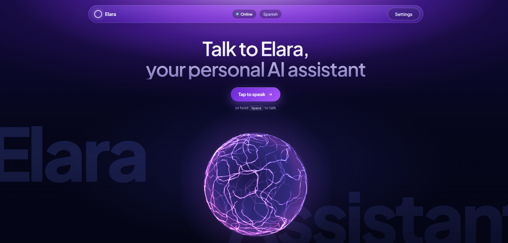

<div align="center">

# ✦ Elara

### A fast, multilingual AI voice assistant with a live plasma-orb interface

Speak in English, Tamil, Hindi or 17 other languages. Elara understands you, replies in the same language, and answers out loud in a natural female voice within about two seconds.



**React 18 · Vite · FastAPI · Groq (Whisper + GPT-OSS 120B) · Microsoft Neural Voices**

</div>

---

## Table of contents

- [Features](#features)
- [How it works](#how-it-works)
- [Tech stack](#tech-stack)
- [Project structure](#project-structure)
- [Getting started](#getting-started)
- [Using Elara](#using-elara)
- [Supported languages and voices](#supported-languages-and-voices)
- [Configuration](#configuration)
- [API reference](#api-reference)
- [Performance](#performance)
- [Troubleshooting](#troubleshooting)

---

## Features

| | |
|---|---|
| 🎙️ **Voice in, voice out** | Click the orb, press the button, or hold **Space**, then speak. Elara transcribes your question, answers and reads the answer aloud. |
| ⚡ **Fast replies** | The reply text arrives in under a second, and the voice **streams** in, so Elara starts speaking about 1.5–2 seconds after you finish. |
| 🌍 **20 languages** | Whisper detects the language you spoke. Elara replies in that language with a native female voice. |
| 🔮 **Audio-reactive plasma orb** | Lightning veins crawl over a rotating 3D sphere drawn on canvas. The orb reacts to your microphone and to Elara's voice, and changes colour for each state: idle, listening, thinking and speaking. |
| 💬 **Chat with memory** | Elara remembers the last 5 question/answer pairs. Replies appear with a typewriter effect and have a Play/Stop button. You can also type instead of speaking. |
| ⚙️ **Settings drawer** | Turn voice and auto-play on or off, change the speaking speed (−20% to +50%), see system info and clear the conversation. Settings are saved in your browser. |
| 🎨 **Modern glass UI** | A violet aurora background, glass pill navigation, gradient headline and large faded background words that change with the state. It works on desktop and mobile and respects *reduced motion*. |

---

## How it works

```
 ┌──────────────┐  audio (webm)   ┌─────────────────────────────────────────┐
 │              │ ──────────────▶ │  FastAPI backend                        │
 │  React UI    │                 │                                         │
 │  (browser)   │                 │  1. Whisper large-v3-turbo  → text +    │
 │              │  JSON reply     │     language                            │
 │  mic ─▶ orb  │ ◀────────────── │  2. GPT-OSS 120B            → answer    │
 │              │                 │     (same language, 1–3 sentences)      │
 │  speaker ◀── │ ◀── MP3 stream ─│  3. edge-tts neural voice   → audio     │
 └──────────────┘   /api/tts      │     streamed chunk by chunk (gTTS       │
                                  │     fallback)                           │
                                  └─────────────────────────────────────────┘
```

1. **Record:** the browser records your voice with `MediaRecorder`. Recordings shorter than 0.45 s are ignored.
2. **Transcribe:** `POST /api/voice` sends the audio to Groq **Whisper**, which returns the text and the detected language.
3. **Think:** the text and recent history go to Groq **`openai/gpt-oss-120b`** with Elara's persona prompt. The reply is short, has no markdown and is in your language.
4. **Speak:** the UI shows the reply right away and plays `GET /api/tts`. That endpoint **streams** MP3 chunks from Microsoft's neural voices as they are generated, so playback starts before the whole sentence has been made.
5. **Visualise:** a Web Audio `AnalyserNode` reads the mic or playback signal and drives the orb's energy, pulses and colours.

---

## Tech stack

**Frontend**
- React 18 + Vite 5
- Canvas 2D plasma-orb renderer with additive blending and 3D sphere projection
- Web Audio API (`AudioContext`, `AnalyserNode`, `MediaRecorder`)
- Plain CSS with glassmorphism, gradients and animations, and the Plus Jakarta Sans font

**Backend**
- Python + FastAPI + Uvicorn
- [Groq](https://groq.com) SDK:
  - `whisper-large-v3-turbo` (speech to text)
  - `openai/gpt-oss-120b` (chat)
- [`edge-tts`](https://github.com/rany2/edge-tts) for Microsoft neural voices, with [`gTTS`](https://github.com/pndurette/gTTS) as a fallback
- `python-dotenv` for the API key

---

## Project structure

```
RAG project/
├── backend/
│   ├── assistant.py      # Core logic: transcribe, generate_reply, stream_speech, voices
│   └── server.py         # FastAPI app: /api/status, /api/voice, /api/chat, /api/tts
├── frontend/
│   ├── index.html
│   ├── vite.config.js    # Dev server on :5173, proxies /api → :8000
│   ├── package.json
│   └── src/
│       ├── main.jsx
│       ├── App.jsx       # State machine, keyboard shortcuts, layout
│       ├── api.js        # Backend calls
│       ├── audioEngine.js# Mic recording, playback, frequency analysis
│       ├── styles.css    # Theme
│       └── components/
│           ├── Orb.jsx           # Audio-reactive plasma orb (canvas)
│           ├── Conversation.jsx  # Chat bubbles, typewriter, composer
│           └── Panels.jsx        # Navbar, SettingsDrawer, Toast
├── docs/
│   └── elara-ui.png      # Screenshot used in this README
├── start.ps1             # One-command launcher (build + serve, or dev mode)
├── requirements.txt      # Python dependencies
├── .env                  # GROQ_API_KEY (not committed)
└── app.py, hud.py        # Legacy Streamlit version (no longer used)
```

---

## Getting started

### Prerequisites

- **Python 3.10+**
- **Node.js 18+** and npm
- A free **Groq API key** from [console.groq.com/keys](https://console.groq.com/keys)
- A microphone and a modern browser (Chrome, Edge or Firefox)

### 1. Create the Python environment

With [uv](https://github.com/astral-sh/uv) (recommended):

```powershell
uv venv .venv
uv pip install -r requirements.txt --python .venv\Scripts\python.exe
```

Or with plain pip:

```powershell
python -m venv .venv
.venv\Scripts\pip install -r requirements.txt
```

### 2. Add your API key

Create a file named **`.env`** in the project root, next to `requirements.txt`:

```env
GROQ_API_KEY=your_groq_api_key_here
```

> ⚠️ Never commit `.env` or share your key.

### 3. Run Elara

```powershell
.\start.ps1
```

This installs the frontend packages the first time, builds the React UI, and starts the server. Open **http://localhost:8000**.

#### Development mode (hot reload)

```powershell
.\start.ps1 -Dev
```

- API on **http://localhost:8000**, with auto-reload in a separate window
- UI on **http://localhost:5173**, using Vite hot module replacement

#### Manual commands

```powershell
# backend
.venv\Scripts\python.exe -m uvicorn backend.server:app --port 8000

# frontend (in another terminal)
cd frontend
npm install
npm run dev      # or: npm run build  (output in frontend/dist, served by FastAPI)
```

> If PowerShell blocks the script, run `Set-ExecutionPolicy -Scope CurrentUser RemoteSigned` once.

---

## Using Elara

| Action | How |
|---|---|
| Start talking | Click **Tap to speak**, click the orb, or **hold Space** |
| Send the recording | Click again, or release **Space** |
| Type a message | Use the message box at the bottom of the chat |
| Stop Elara speaking | Click **Stop speaking** or press **Esc** |
| Replay an answer | Click **Play** on any Elara message |
| Change voice settings | Click **Settings** in the top bar |

**Orb states**

| State | Look |
|---|---|
| Idle | Slow magenta/violet lightning |
| Listening | Bright pink and reacts to your voice |
| Thinking | Fast-spinning blue-violet |
| Speaking | Pulses in time with Elara's voice |

The first time you speak, the browser asks for microphone permission. Choose **Allow**.

---

## Supported languages and voices

Whisper detects the spoken language automatically. For typed input, the language is guessed from the writing script.

| Language | Voice | Language | Voice |
|---|---|---|---|
| English | `en-US-AvaNeural` | Arabic | `ar-SA-ZariyahNeural` |
| Tamil | `ta-IN-PallaviNeural` | French | `fr-FR-DeniseNeural` |
| Hindi | `hi-IN-SwaraNeural` | Spanish | `es-ES-ElviraNeural` |
| Telugu | `te-IN-ShrutiNeural` | German | `de-DE-AmalaNeural` |
| Malayalam | `ml-IN-SobhanaNeural` | Italian | `it-IT-ElsaNeural` |
| Kannada | `kn-IN-SapnaNeural` | Portuguese | `pt-BR-FranciscaNeural` |
| Bengali | `bn-IN-TanishaaNeural` | Russian | `ru-RU-SvetlanaNeural` |
| Marathi | `mr-IN-AarohiNeural` | Japanese | `ja-JP-NanamiNeural` |
| Gujarati | `gu-IN-DhwaniNeural` | Korean | `ko-KR-SunHiNeural` |
| Urdu | `ur-PK-UzmaNeural` | Chinese | `zh-CN-XiaoxiaoNeural` |

Languages without a neural voice fall back to Google TTS (gTTS).

---

## Configuration

These settings are in [`backend/assistant.py`](backend/assistant.py):

| Setting | Default | Description |
|---|---|---|
| `ASSISTANT_NAME` | `"Elara"` | The assistant's name, used in the persona and the UI |
| `USER_NAME` | `""` | Your name, so Elara can greet you personally |
| `CHAT_MODEL` | `openai/gpt-oss-120b` | Groq chat model |
| `STT_MODEL` | `whisper-large-v3-turbo` | Groq speech-to-text model |
| `MAX_HISTORY_MESSAGES` | `10` | Conversation memory (5 question/answer pairs) |
| `DEFAULT_SPEED` | `10` | Voice speed, as a percentage faster than normal |
| `EDGE_VOICES` | see above | Voice for each language. Change one here to use a different voice. |

To list every available voice, run:

```powershell
.venv\Scripts\edge-tts --list-voices
```

The settings in the UI are saved in your browser's `localStorage` under the key `elara.settings`.

---

## API reference

| Method | Endpoint | Body / query | Returns |
|---|---|---|---|
| `GET` | `/api/status` | – | `{ name, chatModel, sttModel, voice, maxHistory, defaultSpeed }` |
| `POST` | `/api/voice` | multipart: `audio` (file), `history` (JSON string) | `{ question, answer, language, languageLabel }` |
| `POST` | `/api/chat` | JSON: `{ text, history }` | `{ question, answer, language, languageLabel }` |
| `GET` | `/api/tts` | `?text=…&lang=en&speed=10` | Streaming `audio/mpeg` |

Error responses:
- `422`: no speech was detected in the recording.
- `502`: the AI service could not be reached.

`history` is a list of `{ "role": "user" | "assistant", "content": "…" }`.

Example:

```powershell
curl -X POST http://localhost:8000/api/chat -H "Content-Type: application/json" `
     -d '{\"text\": \"Tell me a fun fact\", \"history\": []}'
```

---

## Performance

These times were measured on a home broadband connection:

| Step | Time |
|---|---|
| Reply text (`/api/chat`) | 0.5 – 0.9 s |
| First audio chunk (`/api/tts`) | 0.8 – 1.0 s |
| **Question → Elara starts speaking** | **~1.5 – 2 s** |

Three changes make it fast:
- **Streaming TTS:** audio plays as soon as the first chunk arrives, instead of waiting for the whole clip. This cut the delay from about 12 s.
- **Warm-up:** the voice engine is started once when the server boots.
- **Voice choice:** `en-US-AvaNeural` starts about 3× faster than the multilingual Ava voice and sounds the same.

---

## Troubleshooting

| Problem | Fix |
|---|---|
| `GROQ_API_KEY was not found` | Put `.env` in the **project root**, not inside `.venv`. |
| `ModuleNotFoundError: streamlit / fastapi` | Install the requirements into `.venv` (see Getting started). |
| "Could not reach the AI service" | Check your internet connection and API key. The model may have been retired; update `CHAT_MODEL` from [Groq's model list](https://console.groq.com/docs/models). |
| No microphone prompt | Open the app on `localhost` or HTTPS. Browsers block the mic on plain-HTTP remote addresses. |
| "I didn't catch that" | Hold the button or Space a little longer and speak clearly. |
| No sound | Check that **Voice** and **Auto-play** are on in Settings, and that the browser tab isn't muted. |
| Blank page at :8000 | Build the UI first with `cd frontend; npm run build`, or just run `.\start.ps1`. |

---

<div align="center">

Built with React, FastAPI and Groq · Voice by Microsoft Neural TTS

</div>
